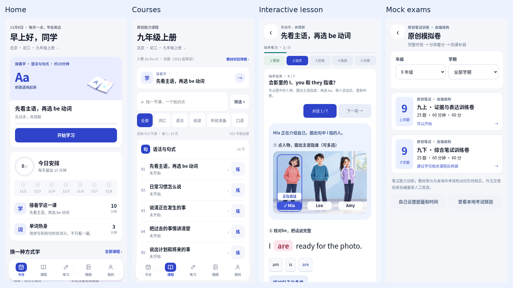

# Individual lesson upgrade — final local review

All 413 lessons now have a separate authored interaction sequence and an inspected review linked in the [tracker](../../authoring/lesson-upgrades.md). This closes the requested local lesson redesign. Content stays draft; native validation, approved audio and publication are separate.

The learning leads with an action, responds to the student's actual error and asks them to use the idea in a fresh task. Grammar changes meaningful conditions and the accompanying model. Vocabulary combines context, recall and original use. Reading requires the actual evidence, including both premises where necessary. Writing uses the student's own plan and revision. Longer material and explanations open when needed. Guided completion remains separate from independent performance.

The final reading lessons add actual sentence insertion between two neighbours, typed short answers with word/form checks, evidence chains, purpose-versus-guarantee contrasts and generated notebook/plant and towel/button observations. Sunday/Friday assessment now follows the taught capitalization rule; ordinary nouns keep normal case-insensitive matching. The whole-app review also corrected immediate quiz feedback to explain the actual selected wrong option; both wrong choices are tested in practice and submitted-paper review. Visual review caught and corrected a hidden single-clue reason field and a transfer premise that had implied learning from demonstration alone.

Validation: all 2,820 core tests across 212 files pass. The final complete standalone suite and both complete 245-pack adapter modes pass. Product navigation, onboarding, mistakes and secondary routes pass. All eight original written mock papers retain timer/resume/flags/answer-sheet/correction checks, separate objective and writing results,24 phone/tablet preflight layouts and 200 rendered explanation figures. The final home-to-course-to-lesson-to-mock journey and its actual screenshots were inspected. [Exact audit and per-lesson source/review hashes](final-course-audit.json) and [final application checkpoint](final-application-checkpoint.json) record the boundary; earlier individual screenshots retain their original checkpoint scope.

A fresh fetch confirms maths main still matches the compared `933ab32` baseline. The maths comparison checks the same concrete teaching contracts: manipulate a meaningful condition, see the result, diagnose a wrong route, repair it and transfer. Rechecked the retained maths captures against their recorded hashes and reopened the English grammar and original-writing evidence. The earlier generic-card baseline has been replaced lesson by lesson. These observations support this local teaching milestone; they do not establish equal learning outcomes or complete native parity.

Local artifacts: `dist/local/index.html`, `dist/local-english-app.zip`, and the importable `dist/english-wechat-development.zip`. Every final source hash and all 245 canonical content-pack hashes are checked. Package limits remain unchanged; 25 older JPEGs were optimized losslessly with identical decoded RGB pixels and dimensions.

Historical DevTools coverage reaches lesson 147, with 805 inspected captures. The final runtime has not received a fresh SDK run. Automatic approval review rejected the later development-source ZIP transfer for source-code egress permission; lessons 148–413 have no new SDK run. No replacement transfer or shared GUI job was attempted. Physical devices, 99 scripts awaiting approved audio, editorial/cohort mapping and production remain pending. Videos are deferred. No content is released or published.
