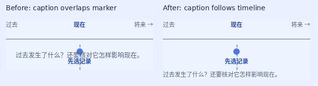

# Self-audit · 9 November 2026

**Verdict: the local course is a credible development candidate; I would not sign off the complete English exam app as matching the maths app’s full demonstrated standard yet.** The sampled interactions now support meaningful manipulation, specific recovery and original production. That does not establish classroom effectiveness, independent writing/speaking transfer or production readiness.

This audit checked all 413 authored definitions and compiled content for systemic changes, then exercised selected real learner flows. It did not repeat a human pedagogical review of every lesson or commission an independent teacher review. Maths main still matches `933ab324`, the compared baseline; no fresh maths native run is claimed.

## Defects found and fixed

| Finding | Correction | Evidence |
| --- | --- | --- |
| All eight mock papers had the same eight-letter reading answer pattern. Knowing another paper’s key could substitute for understanding. | Paper-specific deterministic layouts now produce eight different reading keys and balanced positions. Correct texts and every wrong-option reason stay paired. | [Before/after keys and semantic comparison](content-integrity.json); 168 choices checked against authored answer/reason tuples. |
| Two mock blanks awarded marks for lowercase `wednesday` and `sunday`, contradicting the taught capitalization rule. | Those weekday answers require capitals. Ordinary nouns retain their existing matching rules. | The exact accepted old build awarded 2 marks for `wednesday`; the corrected build awards 0, explains capitalization, and awards 2 for `Wednesday`. |
| A head-measurement component’s global `.time-note` selector placed tense captions over timeline labels. | Scope the absolute footer to its own component; keep timeline captions in flow and let rows grow with their labels. | All 25 timeline conditions and 264 initial/event/width states pass geometry checks and visual inspection. The other component stays pixel-identical at all three widths. |

The preserved [old weekday screenshot](screens/lesson-quality/legacy-mock-6-upper-wednesday.png), [corrected lowercase feedback](screens/lesson-quality/mock-6-upper-wednesday.png) and [accepted capitalized answer](screens/lesson-quality/mock-6-upper-Wednesday.png) show the grading change through the real exam/review controls.

## Teaching judgment

- **Meaningful action and visual consequence:** the source contains 3,095 authored task conditions, including 11 transform-model kinds. Inspected 13 actual workshop starts across grammar, vocabulary, reading, writing, speaking preparation and written pronunciation. The diagram repair demonstrates why counts and earlier green tests were insufficient.
- **Specific feedback and correction:** every one of the 168 mock choice answer/reason pairs is preserved after rearrangement. The current garden-question review explains the selected large-bag mistake and correctly labels both distractors.
- **Original production:** the note task requires both a correct plan and the learner’s own English. Changing the plan invalidates completion; reload preserves the draft and creates no independent attempt. This is guided form/planning evidence, not semantic grading.
- **Transfer remains limited:** all 72 communication lessons end in plan-choice questions. Original text is required earlier, but the final task does not demonstrate independent writing or speaking in the changed context. The next substantive teaching improvement is a separately authored production transfer with an appropriate rubric, rather than treating a multiple-choice plan as proof of performance.
- **Exam alignment remains incomplete:** the eight papers are original written training formats. Verified local city/cohort blueprints, approved listening audio and external editorial review remain open. No full-marks or learning-outcome claim is justified.

## Verification and reproducibility

All 2,823 core tests/213 files, both complete 245-pack adapter modes, grammar/course/teaching/interaction/package checks, cancellation and release guards pass after the final repair. Core mock tests exercise all eight papers; the browser completes one 25-question paper, checks all eight preflights at three widths and renders all 200 explanation figures. The focused standalone audit adds three current weekday exam journeys, one exact historical reproduction, 13 workshop starts and one original-writing/invalidation task.

All 413 compiled lessons, 4,804 course questions and 1,690 vocabulary entries are unchanged. Mock changes are limited to 133 option orders and the two declared capitalization corrections. All 200 mock explanation diagrams are unchanged. [Current source/artifact checkpoint](checkpoint.json), [actual inspection scope](inspection.json) and [archived image hashes](image-hashes.json) preserve the boundaries. Byte-identical figures retain their actual prior inspection; every changed timeline figure was inspected. The full 292-check offline result remains historical Nov7 evidence.

Run `npm run build:local`, `npm run test:lesson-quality`, `npm run test:timeline-layout` and the normal checks. Optional `AUDIT_LEGACY_STANDALONE_GZIP` enables the exact historical reproductions; normal current-build tests need no old archive. The first sandbox browser attempt could not listen on loopback (`EPERM`); the unchanged assertions passed in the outer executor. A timeline-driver jump was corrected to follow the actual sequential controls.

The current local and WeChat development ZIPs pass CRC, exact entry-set and every-source-byte checks. **They are not a release.** Historical actual SDK evidence reaches lesson 147 with 805 inspected captures. Automatic approval review rejected the later source ZIP transfer for source-code egress permission; no replacement transfer or shared GUI job was attempted. The final runtime still needs actual SDK/device checks. Approved audio for 99 scripts / 31 lessons, editorial/cohort mapping and production approval remain pending. Videos are deferred; no content is released or published.
